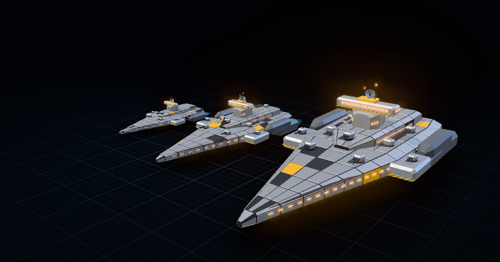

# Shipyard

**Seeded, game-ready low-poly spaceships, generated in your browser.**

Type a seed, pick a class, get a ship. The same seed always rebuilds the same ship, and you can export it as a `.glb` (or a whole fleet as a `.zip`) and drop it straight into Blender, Unity, Godot or Roblox. Everything you generate is **CC0**: use it for anything, no attribution needed.

**Try it:** https://exoticspices.github.io/shipyard/ · **Source:** https://github.com/exoticspices/shipyard



## Features

- **Six classes, six silhouettes.** Fighters, haulers, surveyors, miners, corvettes and racers each have their own hull grammar, so they don't read as one ship with different paint.
- **S / M / L tiers.** A tier changes the silhouette as well as the size. A small fighter is a single-seat dart; a large one adds side nacelles, a dorsal deck, a tandem canopy, twin tails and canards. Each class has a **signature** that grows with the tier (see the table below).
- **Deterministic seeds and permalinks.** The URL hash stores seed, class, tier, livery and sliders. Share a link and the other person gets the same ship.
- **Fleet view.** Nine sibling seeds (`kestrel-4821`, `-4822`, ...) parked in a tidy dock lineup. Click any ship to open it.
- **Tiers view.** One seed side by side at S, M and L.
- **Sliders** for length, greeble/detail density and wing/rig span.
- **Five liveries** (Industrial, Navy, Salvage, Corporate, Stealth). Changing livery swaps material colors only; the mesh doesn't change.
- **Export:** `.glb` for the focused ship, a **fleet `.zip`** with all nine GLBs, PNG screenshots, copy link.
- **Clean capture mode:** add `&ui=0` to the hash (or `?shot` to the URL) to hide all UI and stop the auto-spin. Useful for screenshots and thumbnails.
- No build step, no server, no tracking. One static page plus three.js from a CDN.

Keys: `Space` new ship · `1`–`6` class · `T` tier · `L` livery · `V` view · `F` fleet · `R` spin.

## Classes

| # | Class | Look | Signature (S / M / L) |
|---|-------|------|------------------------|
| 1 | Fighter | dart fuselage, canopy, swept/delta/forward/cranked/X wings | **engines** 1 / 2 / 3 (+ 0 / 2 / 4 missiles) |
| 2 | Hauler | spine with clamped containers/tanks, aft command tower | **containers abreast** 1 / 2 / 3 × slots |
| 3 | Surveyor | slim hull haloed by a sensor ring | **rings** 1 / 1 / 2 · sensor nodes |
| 4 | Miner | segmented boxy hull, intake maw with grinders, crane | **hull segments** 2 / 3 / 4 |
| 5 | Corvette | layered slab hull, command island, turret batteries | **turrets** 2 / 4 / 6 (+ sponsons) |
| 6 | Racer | cockpit hull with dorsal spine, engine nacelles in an arrowhead, catamaran or bundle layout, tied together by a swept wing | **hulls** 3 / 5 / 7 |

## Export notes

Every GLB is in **meters, Y-up, nose toward +Z** (glTF forward) and centered on the origin. Each material channel gets **one mesh and one material**: `primary`, `structure`, `accent`, `accent2`, `glass`, `windows`, `engineGlow`. That makes recoloring or retexturing a single slot easy. Normals are flat (faceted look) and UVs are box-projected at 1 UV unit = 1 m, so a tiling trim/panel texture works without unwrapping. Exhaust plumes and the hover bob exist only in the viewer and are never exported.

- **Blender:** File → Import → glTF 2.0. Scale is already correct. To get the faceted look under smooth shading, leave *Shade Flat* on or add a Weighted Normal modifier.
- **Unity:** install glTFast (`com.unity.cloud.gltfast`), or import through Blender to FBX. One unit is one meter. glTF +Z forward maps onto Unity's +Z forward.
- **Godot 4:** drop the `.glb` into the project and it imports natively. Set `windows` and `engineGlow` to *Unshaded* or give them emission so they glow.
- **Roblox:** use the **3D Importer** (Avatar / Home tab → Import 3D) and set the **scale unit to meters** in the import settings. Roblox needs each mesh **under 20,000 triangles** and works best with **one material per mesh**, which is exactly how Shipyard exports. Every mesh stays well under the limit at default settings; check the in-app readout (`max N/mesh`) if you push the detail slider on large tiers.

## How generation works

Each class is a small **hull grammar**: a handful of rules that place parts relative to each other rather than at fixed coordinates.

1. **Two random streams per ship.** The *style* stream is keyed on `seed + class`, so a seed keeps its family look (wing type, nose, layout, fins) at every tier. The *detail* stream also includes the tier, so plating and greebles vary per size.
2. **Lofted hulls.** Main bodies are lofted from a list of 8-sided cross-sections (`width, height, chamfers, offset` at each station). Noses, tails and humps come from changing those sections.
3. **Attach by query.** Parts ask the hull where to go: `hull.top(z)` puts a canopy on the surface, `hull.at(z)` sizes a collar. That keeps parts attached when proportions change. A dev check flags any part whose bounds don't touch the rest of the ship.
4. **Tier rules.** The tier sets the signature count (engines, hulls, turrets...) and switches on extra structure such as nacelles, decks, canards and sponsons, so larger ships get more complex as well as bigger.
5. **Detail passes.** Panel plating with seam gaps, window strips, hazard chevrons, antennae and greebles are patched onto hull faces at a metric scale.
6. **Merge.** Everything is merged into one triangle soup per material channel, with flat normals and box-projected UVs computed in one pass.

A ship builds in a few milliseconds. Large ships are roughly 3k–15k triangles.

## License

- **Generated ships (the meshes and images you export): CC0 1.0.** Public domain, use them for anything, no attribution required.
- **Source code: MIT.** See [LICENSE](LICENSE).

## Run locally

It's a static site with no build step. Serve the folder over HTTP (ES modules don't load from `file://`):

```sh
npx http-server shipyard -p 8123 -c-1
# or
python -m http.server 8123 --directory shipyard
```

Then open http://127.0.0.1:8123/. three.js loads from jsDelivr via an import map.

Dev tooling lives in `_dev/` (`npm install` there first; uses puppeteer-core with your installed Chrome):

- `node --import ./register.mjs gen-test.mjs`: determinism, NaN, triangle-budget and floating-part checks across many seeds.
- `node glb-check.mjs`, `node zip-check.mjs`: validate exported GLBs and fleet zips from the running app.
- `node shoot.mjs name=hash[@WxH] ...`: headless screenshots. `node og.mjs` regenerates `og.png`.
- `node perf.mjs`, `node leak.mjs`: frame timing and GPU/heap leak checks.
